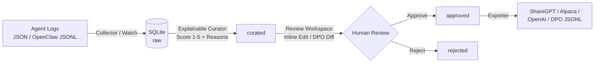

<div align="center">

# HarvestFlow

**Local-first AI agent trajectory curation, explainable scoring, human review, and SFT/DPO dataset export platform.**

[](https://github.com/mcocdaa)
[](https://github.com/mcocdaa/HarvestFlow/actions/workflows/ci.yml)
[](https://github.com/mcocdaa/HarvestFlow/releases)
[](https://www.python.org/)
[](docker-compose.yml)
[](LICENSE)

[English](README.md) · [简体中文](README_CN.md)


</div>

## ✨ Highlights

- **Local-First & End-to-End Audit Trail**: FastAPI + SQLite architecture with a strict `raw → curated → approved/rejected` state machine, single database entry point, and complete audit logging across automated and human actions.
- **Explainable Automated Scoring & PII Redaction**: Rule- and plugin-driven quality evaluation (1–5 scale) that attaches transparent scoring rationales (tool-call success, multi-step reasoning, clear outputs) alongside automated PII scrubbing.
- **Keyboard-First Review Workspace**: High-throughput human-in-the-loop review interface featuring `T` to collapse/expand noisy tool calls and `E` for inline assistant message editing that automatically generates `(chosen, rejected)` DPO preference diffs.
- **Multi-Format Fine-Tuning Export**: One-click dataset filtering (by minimum score, agent role, task type, or tags) and export to `ShareGPT`, `Alpaca`, `OpenAI Messages`, and `DPO` JSONL formats with ZIP batch download and history tracking.
- **Hot-Pluggable Plugins & OpenClaw Integration**: Extensible Collector, Curator, Reviewer, and Service plugins with `before`/`after` short-circuit hooks, persistent directory watching, and bidirectional OpenClaw v3 trajectory ingestion/agent tools (`harvestflow_*`).

## 🚀 Quick Start

### Option 1: Docker Compose (Recommended — 1 Command)

```bash
cp .env.example .env && docker compose up -d --build
```

- **WebUI**: `http://localhost:8001`
- **API Docs (Swagger)**: `http://localhost:3001/docs`

### Option 2: Pre-built GHCR Images

```bash
cp .env.example .env && docker compose pull && docker compose up -d
```

### Option 3: Local Source (`uv` + Node.js 18+)

```bash
./scripts/start.sh local full   # Backend :3000 + Frontend :5173 (stop with ./scripts/stop.sh local)
```

## 🤖 AI / API Usage

Ingest agent trajectories, run explainable quality evaluation, and export curated SFT/DPO datasets via REST API (pass `-H "Authorization: Bearer $HARVESTFLOW_API_KEY"` when authentication is enabled):

```bash
# 1. Upload raw trajectory dataset (OpenAI Messages, ShareGPT, Alpaca, or HarvestFlow JSON/JSONL)
curl -X POST http://localhost:3001/api/v1/collector/upload \
  -H "Content-Type: application/json" \
  -H "X-Filename: agent_sessions.jsonl" \
  --data-binary @agent_sessions.jsonl

# 2. Trigger automated quality scoring & curation (POST /api/v1/curator/evaluate/{session_id} or evaluate-all)
curl -X POST http://localhost:3001/api/v1/curator/evaluate/sess_01 \
  -H "Content-Type: application/json"

# 3. Export approved trajectories to ShareGPT / Alpaca / OpenAI Messages / DPO JSONL
curl -X POST http://localhost:3001/api/v1/exporter/export \
  -H "Content-Type: application/json" \
  -d '{
    "format": "dpo",
    "min_score": 4,
    "agent_role": "coder",
    "version": "v1"
  }'
```

## 🏗️ Workflow & Documentation



<details>
<summary><b>⚙️ Advanced Configuration (<code>.env</code>) & Plugin Architecture</b></summary>

| Variable | Default | Description |
| :--- | :--- | :--- |
| `BACKEND_EXTERNAL_PORT` / `FRONTEND_EXTERNAL_PORT` | `3001` / `8001` | Host ports exposed by Docker Compose |
| `PORT` | `3000` | Local backend server port in source mode |
| `HARVESTFLOW_API_KEY` / `VITE_API_KEY` | *(empty)* | Optional Bearer authentication key for `/api/*` |
| `WATCH_FOLDERS` | *(empty)* | Comma-separated directories for automatic trajectory polling |
| `WATCH_ENABLED` / `WATCH_INTERVAL_SECONDS` | `false` / `30` | Background directory watcher toggle and polling interval (seconds) |
| `OPENCLAW_AGENTS_DIR` | *(empty)* | OpenClaw v3 exported session directory |
| `CURATOR_ENABLED` / `AUTO_APPROVE_THRESHOLD` | `true` / `4` | Automated scoring toggle and score threshold for auto-approval |
| `DATA_DIR` / `DB_PATH` / `PLUGINS_DIR` | `./backend/data` | Local storage and plugin directories (mapped to `/app/*` in Docker) |
| `LOG_LEVEL` | `INFO` | Logging verbosity (`DEBUG` / `INFO` / `WARNING` / `ERROR`) |

**Plugin System (`plugins/`)**:
- Supports hot-pluggable **Collector**, **Curator**, **Reviewer** (schema-driven custom review fields persisted in `review_meta`), and **Service** plugins.
- Exposes OpenClaw agent tools (`harvestflow_list`, `harvestflow_scan_import`, `harvestflow_evaluate`, `harvestflow_review`).
- See [plugins/README.md](plugins/README.md) for custom plugin authoring and OpenClaw extension setup.

</details>

### 📚 Documentation & Resources

- **Documentation Index**: [docs/index.md](docs/index.md)
- **Architecture & Hook Guide**: [docs/project/architecture_guide.md](docs/project/architecture_guide.md)
- **Plugin Authoring Guide**: [plugins/README.md](plugins/README.md)
- **Product Roadmap**: [future_plan.md](future_plan.md)

## 📄 License

Released under the [MIT License](LICENSE).
