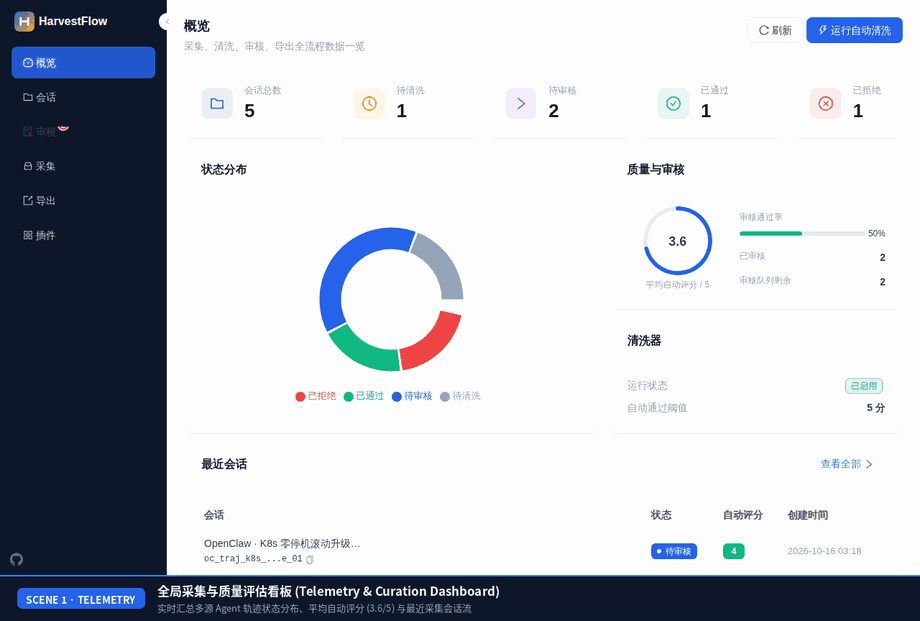
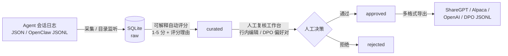

<div align="center">

# HarvestFlow

**本地优先的 AI Agent 轨迹采集、可解释自动评分、人工复核与 SFT/DPO 微调数据集导出平台。**

[](https://github.com/mcocdaa)
[](https://github.com/mcocdaa/HarvestFlow/actions/workflows/ci.yml)
[](https://github.com/mcocdaa/HarvestFlow/releases)
[](https://www.python.org/)
[](docker-compose.yml)
[](LICENSE)

[English](README.md) · [简体中文](README_CN.md)



</div>

## ✨ 核心特性

- **本地优先与全链路审计闭环**：基于 FastAPI + SQLite 构建，严格执行 `raw → curated → approved/rejected` 状态机流转、唯一落库入口与全链路审计日志，数据不出本机。
- **可解释自动评分与敏感信息脱敏**：每份轨迹评分（1–5 分）均附带透明可解释的评分依据（工具调用成功率、多步推理链、明确输出等），并内置自动 PII 隐私脱敏能力。
- **键盘优先的高效人工复核工作台**：支持快捷键高效标注（`T` 一键折叠/展开工具调用详情，`E` 行内编辑 Assistant 回复并自动生成 `(chosen, rejected)` DPO 偏好对齐样本对）。
- **多格式微调数据集一键导出**：支持按最低分、Agent 角色、任务类型与标签筛选，一键导出为 `ShareGPT`、`Alpaca`、`OpenAI Messages` 与 `DPO` JSONL 格式，支持 ZIP 批量打包下载与历史回溯。
- **插件热插拔与 OpenClaw 双向集成**：内置 Collector / Curator / Reviewer / Service 四类插件与 `before`/`after` 短路钩子，支持目录持久化轮询采集，并与 OpenClaw v3 导出解析及 `harvestflow_*` Agent 工具双向打通。

## 🚀 快速开始

### 方式一：Docker Compose（推荐 — 一键启动）

```bash
cp .env.example .env && docker compose up -d --build
```

- **前端 WebUI**：`http://localhost:8001`
- **后端 API 文档 (Swagger)**：`http://localhost:3001/docs`

### 方式二：使用 GHCR 预构建镜像

```bash
cp .env.example .env && docker compose pull && docker compose up -d
```

### 方式三：本地源码运行（`uv` + Node.js 18+）

```bash
./scripts/start.sh local full   # 后端 :3000 + 前端 :5173（停止请运行 ./scripts/stop.sh local）
```

## 🤖 AI 与 API 接口

通过 REST API 实现 Agent 轨迹流式上传、可解释自动评分与微调数据集导出（开启鉴权时请携带 `-H "Authorization: Bearer $HARVESTFLOW_API_KEY"`）：

```bash
# 1. 上传原始轨迹数据集（支持 OpenAI Messages、ShareGPT、Alpaca 或 HarvestFlow JSON/JSONL）
curl -X POST http://localhost:3001/api/v1/collector/upload \
  -H "Content-Type: application/json" \
  -H "X-Filename: agent_sessions.jsonl" \
  --data-binary @agent_sessions.jsonl

# 2. 触发可解释自动评分与清洗（POST /api/v1/curator/evaluate/{session_id} 或 evaluate-all）
curl -X POST http://localhost:3001/api/v1/curator/evaluate/sess_01 \
  -H "Content-Type: application/json"

# 3. 将已通过复核的轨迹导出为 ShareGPT / Alpaca / OpenAI Messages / DPO JSONL 数据集
curl -X POST http://localhost:3001/api/v1/exporter/export \
  -H "Content-Type: application/json" \
  -d '{
    "format": "dpo",
    "min_score": 4,
    "agent_role": "coder",
    "version": "v1"
  }'
```

## 🏗️ 工作流与文档



<details>
<summary><b>⚙️ 高级配置项 (<code>.env</code>) 与插件体系说明</b></summary>

| 配置项 | 默认值 | 说明 |
| :--- | :--- | :--- |
| `BACKEND_EXTERNAL_PORT` / `FRONTEND_EXTERNAL_PORT` | `3001` / `8001` | Docker Compose 对外映射端口 |
| `PORT` | `3000` | 本地源码模式后端监听端口 |
| `HARVESTFLOW_API_KEY` / `VITE_API_KEY` | *(空)* | 可选 Bearer 鉴权密钥（保护 `/api/*`） |
| `WATCH_FOLDERS` | *(空)* | 初始自动监听与扫描目录（多个目录用逗号分隔） |
| `WATCH_ENABLED` / `WATCH_INTERVAL_SECONDS` | `false` / `30` | 自动监听开关与后台轮询间隔（秒），前端采集页设置可持久化 |
| `OPENCLAW_AGENTS_DIR` | *(空)* | OpenClaw v3 导出数据目录 |
| `CURATOR_ENABLED` / `AUTO_APPROVE_THRESHOLD` | `true` / `4` | 自动评分开关与自动通过阈值 |
| `DATA_DIR` / `DB_PATH` / `PLUGINS_DIR` | `./backend/data` | 本地数据与插件目录（Docker 内部固定为 `/app/*`） |
| `LOG_LEVEL` | `INFO` | 日志级别（`DEBUG` / `INFO` / `WARNING` / `ERROR`） |

**插件体系 (`plugins/`)**：
- 已落地 **Collector**、**Curator**、**Reviewer**（Schema 驱动扩展字段 + `review_meta` 持久化）与 **Service** 四类插件。
- 向 OpenClaw Agent 暴露 `harvestflow_list`、`harvestflow_scan_import`、`harvestflow_evaluate`、`harvestflow_review` 扩展工具。
- 插件接口定义与 OpenClaw 扩展配置详见 [plugins/README.md](plugins/README.md)。

</details>

### 📚 文档与资源

- **文档导航索引**：[docs/index.md](docs/index.md)
- **架构与 Hook 机制指南**：[docs/project/architecture_guide.md](docs/project/architecture_guide.md)
- **插件开发指南**：[plugins/README.md](plugins/README.md)
- **版本演进规划 (Roadmap)**：[future_plan.md](future_plan.md)

## 📄 许可证

本项目基于 [MIT License](LICENSE) 开源。
